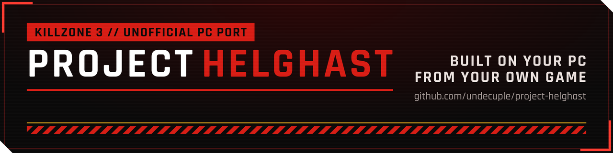
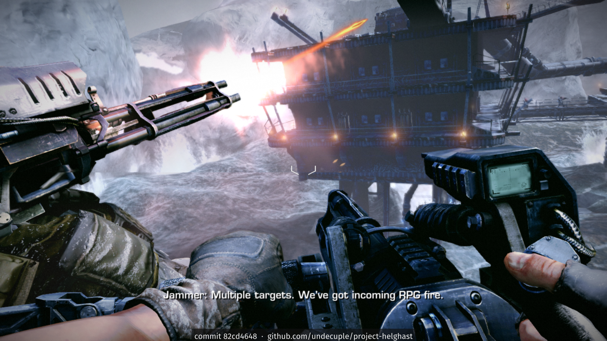

<p align="center">
  
</p>

# Project Helghast (work in progress)

**Killzone 3 // Unofficial PC Port (static recompilation)**

[](https://github.com/undecuple/project-helghast/actions/workflows/ci.yml)
[](LICENSE)

[](https://github.com/undecuple/project-helghast/releases)
[](https://github.com/undecuple/project-helghast/releases)


**[Status](#status)** · **[Features](docs/FEATURES.md)** · **[Requirements](docs/requirements.md)** · **[Getting it](#getting-it)** · **[Screenshots](docs/SCREENSHOTS.md)** · **[Building](docs/BUILDING.md)** · **[How it works](docs/HOW-IT-WORKS.md)** · **[Known issues](docs/KNOWN_ISSUES.md)** · **[Release criteria](docs/RELEASE-CRITERIA.md)** · **[AI use](#how-ai-was-used)** · **[Changelog](CHANGELOG.md)** · **[Roadmap](docs/ROADMAP.md)** · **[Contributing](.github/CONTRIBUTING.md)**

*Helghast* is the name of the game's own faction; Project Helghast is a fan project, not official and not
affiliated with or endorsed by Sony Interactive Entertainment or Guerrilla Games.

You need your own Killzone 3 disc dump, the 1.14 update and a decrypted EBOOT from your own copy. Version 0.1.0 is a pre-release: partly playable, see [docs/RELEASE-CRITERIA.md](docs/RELEASE-CRITERIA.md).

A PC port of **Killzone 3** (PS3, 2011) made by **static recompilation**: the game's PowerPC (PPU) and Cell SPU
code is translated to C ahead of time and compiled into a native Windows x64 program, so no CPU emulator runs at
play time. The PS3 system software the game calls is reimplemented on PC APIs. The hardware around the code is
still provided by a runtime layer, much as an emulator provides it: the game's GPU command stream is translated
to Direct3D 12 as it runs, and SPU scheduling, DMA and the PS3's memory layout are reproduced. Those layers are
replaced by native code step by step: [what is native today](docs/HOW-IT-WORKS.md#what-kind-of-port-is-this).

> **Status: partly playable.** Levels load and play at about 16-22 frames/s (target 30), with known bugs; the campaign has not been played start to finish yet. Tested on
> Windows x64, mostly under Proton; first runs on native Windows 11 on 2026-10-21. What works: the table under [Status](#status). A first release that calls itself playable waits for the conditions in [docs/RELEASE-CRITERIA.md](docs/RELEASE-CRITERIA.md).

<p align="center">
  <a href="docs/SCREENSHOTS.md"></a><br>
  <sub>Frozen Shores at 1920x1080 on the current build. More, by milestone: <a href="docs/SCREENSHOTS.md">screenshots</a>.
  Game imagery © Sony Interactive Entertainment.</sub>
</p>

**You need your own copy of the game.** This repository contains only the port: source code, patches to the
recompiler, tools and documentation. It contains no game code, data, assets, keys or firmware, and it never will.
Killzone 3 is © Sony Interactive Entertainment; this project is not affiliated with or endorsed by Sony or
Guerrilla Games.

## Status

As of 2026-10-27, on Windows x64, tested mostly under Proton on Linux (first runs on native Windows 11 on 2026-10-21 and on a Windows 10 test machine on 2026-10-22):

| | |
|---|---|
| Boot, intro, menus | work at the game's 30 fps; the menu background's red haze and glow match the PS3 emulator RPCS3. Latin and Cyrillic text uses an open-font fallback; Chinese, Korean and Japanese text needs the PS3 system fonts, an optional folder you point the installer at from your own console's firmware files (no firmware is needed otherwise) |
| First level | loads and runs for 10+ minutes (16 of 16 test runs clean). The video decoder threads are kept on performance cores of hybrid CPUs (`KZ3_SPU_PCORES=0` turns that off), because on efficiency cores they are the cause found for the loading-screen stall; no frame-rate effect was measured and the stall itself was not seen in those runs |
| In-level HUD | drawn: level 2 shows the objective banner, ammo, grenades and crosshair; in the first level's opening the game shows only the objective marker and reticle, the same as the RPCS3 emulator at that point |
| Input | Xbox (XInput) controllers work directly and PlayStation pads through Steam Input, with the game's own button layout and vibration; SDL3 input (DualShock 4, DualSense, Switch Pro, Xbox pads, rumble, motion sensors) is built in and only partly confirmed on real hardware. Layouts: the game's own, a modern-shooter preset, or a custom one set in an in-game editor. Keyboard and mouse work in the menus and in levels, with rebindable keys and mouse look (sensitivity under Options > Mouse). Details and what is not yet checked: [FEATURES.md](docs/FEATURES.md) |
| Display | windowed or borderless with Alt+Enter, exclusive fullscreen as a setting, stretched or aspect-kept picture, bilinear or nearest filtering, VSync on or off, a Bloom setting, a frame rate limit of 30, 60 or 120 and a Field of view setting (Options > Display). In gameplay the view follows the window's shape (ultrawide and 16:10); the HUD, menus, subtitles and movies stay 16:9 and centred. Checked by hand at 1920x1080, other shapes only in test runs. Details: [FEATURES.md](docs/FEATURES.md) |
| Campaign beyond level 1 | all 9 chapters load and play for minutes with a picture (picked with Select Chapter from a finished save; about 16-22 frames/s on a first visit depending on the chapter, one scripted run each on 2026-10-27). One chapter, Pyrrhus Outskirts (level 202), has been played by hand to its end in one session (about 29 minutes from a checkpoint, with a few bugs noted); the others have not been played through |
| Saves | checkpoints save during play, Continue reloads them in a fresh run, and quitting to the main menu from the pause menu works; the save's PARAM.SFO is in the PS3's own format (moving a save to a console or an emulator is not tested) |
| Update 1.14 | the port is built on update 1.14; all nine chapters load and play for minutes, each reaching its level start and autosave (scripted runs) |
| Split-screen co-op | the game's own two-player campaign co-op works on one PC with two controllers (vertical split, about 26 frames/s); the two views sit slightly out of place and the right-hand view can flicker (both under investigation); keyboard and mouse as one of the two players is planned |
| Botzone | with the game's own patch layer applying the 1.14 update (`KZ3_NATIVE_PATCH`, on by default), Botzone reaches Career Selection (Corinth Highway) and the campaign levels 200-208 all load (scripted runs, 2026-10-27); no full Botzone match has been played by hand |
| Online | the game's own client signs in to a local test server and reaches the MULTIPLAYER menu; joining a game is not built; online co-op campaign is on the wanted list |
| Installer and portable zip | both work end to end in testing under Proton; on native Windows 11 the installer builds the game in about 7 minutes and the game reaches the menus (checked 2026-10-21) |
| Performance | a pipeline list from all eight chapters ships with the game, so shaders build in the background while a level loads (about 16.5 frames/s in the busy first minute of a level's first visit, with little stutter); the shader cache carries over between sessions (a warm start builds about 15 shaders instead of about 1,200). Planned: the game builds every shader in the shipped list at its first launch; until then the installer offers an optional shader warm-up step (about 17 minutes, off by default) |
| Speed | about 22-23 frames/s in a busy Frozen Shores window (131-180 s after launch; in-level figures, means of alternated runs on 2026-10-27), target 30; the slowest 1 % of frames run at about 13-14 frames/s; menus and cutscenes hold 30. The renderer's command walker and the SPU job code are the limits, and the PS3 emulator RPCS3 holds 30 on the same scene and machine, so 30 is reachable |
| Known bugs | the full list is in [KNOWN_ISSUES.md](docs/KNOWN_ISSUES.md); audio stutters now and then in levels (the audio mixing code is about 1.2 % short of real time); windows and sky in far views look flat white |

Feature by feature, the PS3 game against the port, and what the port adds: [FEATURES.md](docs/FEATURES.md), with an estimated parity figure overall and per area (generated from the
repo's own records). How the port works: [docs/HOW-IT-WORKS.md](docs/HOW-IT-WORKS.md).

## What goes online

Nothing, unless you ask for it. Each item is off until you turn it on, and this list names every one:

- **New-version check** (installer and portable zip): one anonymous request to GitHub for this
  repository's latest release, made only when you click "Check now" or tick "Check for new versions" (then at most
  once a day). Nothing about you, your computer or the game is sent; a new installer downloads only when you click it.
- **Crash reports** (planned; installer, Advanced page): when ticked, a crash (or a serious warning, at most once per
  session) sends its stack trace and the port's log, with user names, host names and addresses removed, to the
  project's own error tracker. No usage data, never a memory dump. Off unless you tick it.
- **Project website** (`site/`): viewing it loads the Rajdhani and Barlow fonts from Google Fonts, which sees your visit. The repository, installer and game do not.
- **Online multiplayer** (planned): only through a self-hosted server you choose.
- **Discord status** (optional, off unless you set `discord_presence = 1` in `kz3.ini`): the port tells the Discord
  app on your own PC what to show on your profile (the activity text, the game's process id and the port's Discord
  application id), through the app's local connection. The port itself sends nothing over the network for it; the
  Discord app shares the status as it does for other games. Still being tested.

The original PS3 game's online play is kept running by the PS Rewired community
([their Killzone 3 page](https://psrewired.com/servers/23044)). This port is not affiliated with or endorsed by
PS Rewired and does not connect to their servers.

## Where your data goes

Saves and settings go to `%APPDATA%\Project Helghast`, and caches (shaders) to `%LOCALAPPDATA%\Project Helghast`.
To keep everything in the game folder instead, drop an empty file named `portable.txt` next to the launcher. For one
run only, start the launcher with `--portable` or `--appdata` (no file changes). Always start the game through the
launcher: `kz3.exe` started directly does not apply any of this. The launcher's log (`logs\launcher.log`) and the
Start-menu "Open saves folder" entry say which rule decided, for example `data: portable (portable.txt)`. The
"Move saves and settings" entry moves your files and creates or removes `portable.txt` to match.

## Getting it

**Download:** [v0.1.0](https://github.com/undecuple/project-helghast/releases/tag/v0.1.0) is a pre-release (partly
playable). Get `Project-Helghast-setup.exe` (recommended) or the portable zip from the
[releases page](https://github.com/undecuple/project-helghast/releases) and check it against `SHA256SUMS`. The installer
checks your own disc dump, 1.14 update and decrypted EBOOT, then recompiles and builds the game's code on your own
machine with a bundled compiler (about 10-30 minutes on the first start). No game code, assets or keys are ever shipped
or downloaded. You can also build it yourself (below). What a release must meet to be called playable is in
[docs/RELEASE-CRITERIA.md](docs/RELEASE-CRITERIA.md).

**Always start the game through the launcher (`Project Helghast.exe`, or the desktop and Start-menu shortcuts).**
`kz3.exe` started directly skips the launcher's work: it does not apply the data-location rules (saves, settings and
caches would land in the wrong folder) or your launch settings, and it does not check that your install is current.

## Requirements

See [docs/requirements.md](docs/requirements.md): the US disc (BCUS98234) dumped as a folder, the 1.14 update,
the decrypted EBOOT of your own copy (no firmware needed; this project doesn't provide decryption tools or instructions; the PS3 emulator RPCS3 and its documentation are the usual place people start), and a Direct3D 12 GPU. Hardware figures are provisional until
the game runs at speed.

## Building

The port is built on [ps3recomp](https://github.com/sp00nznet/ps3recomp) (MIT), pinned as a submodule at v0.18.0 (commit 4e8f3ca), with the
patches in [port/patches/](port/patches/) applied on top. The toolchain is a Nix flake (MinGW-w64 cross build on
Linux); Windows builds are tested mostly under Proton, plus first runs on native Windows 11 and Windows 10.

```sh
git clone --recursive https://github.com/undecuple/project-helghast
nix develop .#re   --command tools/sandbox.sh -- tools/lift.sh                 # recompile the PPU code
nix develop .#re   --command tools/sandbox.sh -- tools/spu/lift_spu.sh         # recompile the SPU code
nix develop .#win  --command tools/sandbox.sh -- tools/build-kz3.sh build/kz3-win
```

Full steps (game files, SPU inventory, configure, staging, running under Proton, tests without the game):
[docs/BUILDING.md](docs/BUILDING.md).

`kz3.exe` needs no launch options: next to the `PS3_GAME` folder of your dump (the staged layout) it starts as it
is, from a double-click or a plain Steam shortcut; elsewhere it reads `kz3.ini` beside it, which names the
decrypted EBOOT and the other folders ([docs/BUILDING.md](docs/BUILDING.md#running)).

## How it works, briefly

- **PPU:** ~59,000 functions lifted to C by ps3recomp's lifter; a few are replaced by host code (fiber scheduler,
  heap, movie skip) through override hooks.
- **SPU:** all 22 embedded SPU programs and 75 SPURS job modules lifted; SPURS runs on host threads.
- **Graphics:** the game's RSX command stream is walked and replayed on Direct3D 12 (shaders translated from RSX
  microcode), including the SPU post-processing chain's read-backs.
- **Data:** the game's archive is read in place through a case-insensitive virtual file system; the 1.14 update is
  layered over the disc data as the PS3 does.

More detail: [docs/HOW-IT-WORKS.md](docs/HOW-IT-WORKS.md); terms: [docs/GLOSSARY.md](docs/GLOSSARY.md).
General fixes found here are offered to ps3recomp upstream (see [CONTRIBUTING.md](.github/CONTRIBUTING.md)).

## How AI was used

The port is developed by one person with AI coding agents (the hands-on work is done by AI assistants run under the maintainer's direction). The agents do
most of the hands-on work: reading the game's binary and the reference material, writing and testing patches, tools
and documentation, and running the builds and test runs. The game and its files are only handled inside a sandbox, with
the game files read-only and no network access. The maintainer sets the goals and priorities, plays the builds, signs
off everything that is published, and is responsible for it. Status claims are dated and say how they were checked;
guesses are marked `ASSUMPTION:` until they are confirmed in the binary. The PS3 emulator RPCS3 is read as a reference,
never copied. If you find a statement here that was not verified, please open an issue.

## Roadmap

Playable campaign at speed and the local-build installer first; then more PC options (higher internal resolutions, keyboard and mouse for the second co-op player), Botzone and online play through a self-hosted server, a native Linux build, and later mod support.
Gameplay changes stay optional. See [ROADMAP.md](docs/ROADMAP.md).

## Related projects

**Project Pyrrhus**: Killzone 2 (PS3) ported to PC the same way, by static recompilation. In development, not
public yet; a link follows when it is.

**Planned:** once the Killzone 2 and Killzone 3 ports are finished, the same static recompilation approach will be
applied to every Ratchet & Clank game released on the PS3.

**Other PS3 games:** suggest one, or upvote someone else's, in [Game requests](https://github.com/undecuple/project-helghast/discussions/categories/game-requests). It is a wish list, not a
promise: a game is picked only when its code suits this approach and the work on these ports allows it.

## Official channels

Project Helghast is made by **undecuple**: GitHub [@undecuple](https://github.com/undecuple), Reddit [u/RelationshipNo4440](https://www.reddit.com/user/RelationshipNo4440), Discord **itekso.** (on the ps3recomp server). Builds and fixes come only from this repository's [GitHub Releases](https://github.com/undecuple/project-helghast/releases); we never ask anyone to paste a command into PowerShell or a terminal. Anyone else offering builds, "fixes" or donations in this project's name is not us.

## Contributing

Pull requests and feature requests are welcome. For anything big, open an issue first so we can agree on the approach
before you spend the time. There is no promise of a review time, or of merging every request; this is a small project.

- No game files, keys or links to pirated copies, in code, issues, pull requests or logs.
- Code must be MIT-compatible. Code under GPL or LGPL needs the maintainer's agreement first (RPCS3, for one, is a reference to read, not code to copy).
- If an AI tool helped write your change, say so in the pull request.
- Use the [issue forms](.github/ISSUE_TEMPLATE) (bug report, performance report, feature request, feedback, pipeline template) and fill in the [pull request template](.github/pull_request_template.md).

Details: [CONTRIBUTING.md](.github/CONTRIBUTING.md). Things already known to be wrong: [docs/KNOWN_ISSUES.md](docs/KNOWN_ISSUES.md). Security problems: [SECURITY.md](.github/SECURITY.md). Copying or forking the project: [docs/FORKING.md](docs/FORKING.md).

## Repository layout

| Entry | What it is |
|---|---|
| `README.md` | This page. |
| `LICENSE` | The licence; GitHub reads it from the root. |
| `CHANGELOG.md` | What each release contains, newest first. |
| `NOTICE.md` | Short credits list; the licence texts are in `licenses/`. |
| `licenses/` | Full licence texts of what the installer and portable zip ship (see its README). |
| `CITATION.cff` | Citation data; GitHub reads it from the root for the "Cite this repository" button. |
| `AGENTS.md` | Orientation for automated coding assistants working in the repository. |
| `flake.nix`, `flake.lock` | The Nix development shells and their pinned inputs; Nix reads the flake from the root. |
| `ruff.toml` | Python lint settings; ruff looks for it in the root. |
| `.clang-format`, `.editorconfig`, `.gitattributes`, `.gitignore`, `.gitleaks.toml`, `.gitmodules` | Tool configuration (formatting, line endings, ignored files, secret scan, the submodule list); each tool reads its file from the root. |
| `.recomp.json` | Machine-readable project card (game, region, status) for recompilation-project directories. |
| `.github/` | CI, release and website workflows, issue templates, contributing and security notes, funding link. |
| `assets/` | Banner and social-preview images. |
| `cmake/` | CMake toolchain files for the MinGW-w64 and llvm-mingw builds. |
| `docs/` | Building, how it works, known issues, features, roadmap, glossary and screenshots. |
| `installer/` | Inno Setup script and art for the Windows installer, and `pso-template.bin`, a shader warm-up list that holds pipeline-state hashes and numeric render state only (no shader text, no game code). |
| `port/` | The port's own code: the game glue (`kz3`), networking, patches for ps3recomp, SPU and file-system code. |
| `re/` | Data tables the lift tools read (override and seed lists). |
| `site/` | Source of the project web page. |
| `tools/` | Lift, build, stage, test and release scripts; see [tools/README.md](tools/README.md). |
| `third_party/ps3recomp` | The ps3recomp submodule (MIT), pinned; fetched with `git submodule update --init`. |

## Licence

The port's own code, tools and documentation: [MIT](LICENSE). Third-party components and credits: [NOTICE.md](NOTICE.md).
The licence covers nothing of the game itself.

**Reusing this work, including by AI systems and automated tools:** the MIT licence applies to every use,
including crawling, indexing, training and code generation. Copies or substantial portions must keep the copyright
and permission notice, and we ask that derived work credits "Project Helghast by undecuple" with a link to this
repository. Details: [NOTICE.md](NOTICE.md#reuse-and-attribution-including-ai-and-automated-use); citation data:
[CITATION.cff](CITATION.cff).
