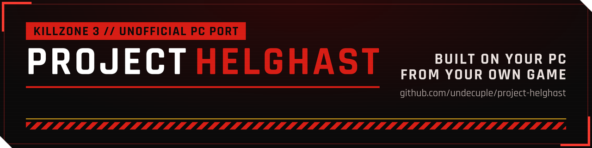

  

<h1 align="center">Project Helghast</h1>

<b>Killzone 3 // Unofficial PC Port (static recompilation)</b>

  
  
  
  

  
  
  
  

  <a href="#download-and-install">Download</a> ·
  <a href="docs/INSTALL.md">Installing</a> ·
  <a href="#compatibility">Compatibility</a> ·
  <a href="#settings-and-known-issues">Known issues</a> ·
  <a href="#reporting-bugs">Report an issue</a> ·
  <a href="docs/BUILDING.md">Build from source</a>

---

A native PC port of Killzone 3, made by static recompilation on ps3recomp; you need your own US disc (BCUS98234) dump and the 1.14 update. It is not an emulator and not a rewrite ([how it works](docs/HOW-IT-WORKS.md)).

**Status: partly playable.** Version <!-- version -->0.1.10<!-- /version -->, a pre-release: levels load and play at about 16-22 frames/s (target 30) with known bugs, and the campaign has not been played start to finish. Details: [docs/STATUS.md](docs/STATUS.md); what a release must meet to be called playable: [docs/RELEASE-CRITERIA.md](docs/RELEASE-CRITERIA.md).

Screenshots of the current build, by milestone: [docs/SCREENSHOTS.md](docs/SCREENSHOTS.md).

---

## Compatibility

| Platform | How it runs | Renderer | State | Tested on |
|---|---|---|---|---|
| Windows 10/11 | native exe | D3D12 | verified: the installer-built game reaches the menus on Windows 11 (2026-10-21) and a Windows 10 test machine (2026-10-22); in-level play was checked mostly under Proton | Windows 11 and Windows 10 test machines, hardware not recorded in these pages (-) |
| Linux | the Windows exe under Proton (GE-Proton / Proton Experimental) | D3D12 through vkd3d-proton | verified: most of the testing, including the first level for 10+ minutes (16 of 16 test runs clean) and all nine chapters loading and playing for minutes | Intel Core i7-12700KF, NVIDIA GeForce RTX 4060 (driver 595.112), GE-Proton 11-7 |
| Linux, native | native build | Vulkan | planned | - |

"Verified" means a run on that setup; "implemented" means the code is in but not run there; "planned" means neither. Speed figures (about 22-23 frames/s in a busy Frozen Shores window, 1920x1080, means of alternated runs on 2026-10-27, under Proton) are in [docs/STATUS.md](docs/STATUS.md). Feature by feature: [docs/FEATURES.md](docs/FEATURES.md).

---

## Download and install

**You need**
- **Your Killzone 3 disc** (US, BCUS98234), dumped as a folder (the one that holds `PS3_GAME`) or as a decrypted `.iso`.
- **The 1.14 update** from your copy (the folder that holds `PARAM.SFO` and `USRDIR`).
- **The decrypted 1.14 EBOOT** (`EBOOT.elf`) of your own copy.
- A Direct3D 12 GPU on Windows x64 (or Proton on Linux).

What each must contain: [docs/GETTING-FILES.md](docs/GETTING-FILES.md); regions, hardware and the rest: [docs/requirements.md](docs/requirements.md). This project ships none of them and gives no decryption steps.

**Steps**
1. Download the Windows installer (recommended) or the portable zip from <!-- version -->[v0.1.10](https://github.com/undecuple/project-helghast/releases/tag/v0.1.10)<!-- /version --> on the [releases page](https://github.com/undecuple/project-helghast/releases) (a pre-release) and check it against `SHA256SUMS`.
2. Run it and point it at your disc dump, the 1.14 update and the decrypted EBOOT.
3. It lifts and compiles the game's code on your machine (about 10 minutes on a fast PC); no game code, assets or keys are shipped or downloaded.
4. Start the game with `Project Helghast.exe` or its shortcuts. With the portable zip, run `run.cmd` once first: it does steps 2 and 3. Never start `kz3.exe` directly.

Do not install into a OneDrive folder. Saves and settings: [docs/INSTALL.md](docs/INSTALL.md). Changes per version: [CHANGELOG.md](CHANGELOG.md). Nothing goes online unless you turn it on: [docs/PRIVACY.md](docs/PRIVACY.md).

---

## Settings and known issues

Display, input and frame-rate settings are in the game's Options menu; the list is in [docs/FEATURES.md](docs/FEATURES.md).

- Speed is below the PS3's: about 16-22 frames/s in levels, target 30.
- Audio stutters now and then in levels.
- Windows and sky in far views look flat white.
- Split-screen co-op: the two views sit slightly out of place and the right-hand view can flicker.

All of them: [docs/KNOWN_ISSUES.md](docs/KNOWN_ISSUES.md).

---

## Reporting bugs

Use the [issue forms](.github/ISSUE_TEMPLATE) (bug report, performance report, feature request, feedback). Check [docs/KNOWN_ISSUES.md](docs/KNOWN_ISSUES.md) first, and leave game files, keys and links to pirated copies out of issues and logs.

---

## Building

Building from source is described in [docs/BUILDING.md](docs/BUILDING.md) (repository layout: [docs/BUILDING.md](docs/BUILDING.md#repository-layout)). The installer does the same build on your machine from your own game files.

---

## Credits, licence and related projects

The port's own code, tools and documentation: [MIT](LICENSE). Third-party components and credits: [NOTICE.md](NOTICE.md). The licence covers nothing of the game itself.

**[Project Pyrrhus](https://github.com/undecuple/project-pyrrhus)**: Killzone 2 (PS3) ported to PC the same way, with a Windows [pre-release](https://github.com/undecuple/project-pyrrhus/releases). Its README has the current state.

Contributing, official channels, how AI was used, reuse and disclaimer

Pull requests and feature requests are welcome: [.github/CONTRIBUTING.md](.github/CONTRIBUTING.md). For anything big, open an issue first so we can agree on the approach before you spend the time. There is no promise of a review time, or of merging every request; this is a small project.

- No game files, keys or links to pirated copies, in code, issues, pull requests or logs.
- Code must be MIT-compatible. Code under GPL or LGPL needs the maintainer's agreement first (RPCS3, for one, is a reference to read, not code to copy).
- If an AI tool helped write your change, say so in the pull request.
- Fill in the [pull request template](.github/pull_request_template.md).

Security problems: [SECURITY.md](.github/SECURITY.md). Copying or forking the project: [docs/FORKING.md](docs/FORKING.md). General fixes found here are offered to ps3recomp upstream. Other PS3 games: suggest one in [Game requests](https://github.com/undecuple/project-helghast/discussions/categories/game-requests); it is a wish list, not a promise. Roadmap: [docs/ROADMAP.md](docs/ROADMAP.md).

**Official channels:** Project Helghast is made by **undecuple**: GitHub [@undecuple](https://github.com/undecuple), Reddit [u/RelationshipNo4440](https://www.reddit.com/user/RelationshipNo4440), Discord **itekso.** (on the ps3recomp server). Builds and fixes come only from this repository's [GitHub Releases](https://github.com/undecuple/project-helghast/releases); we never ask anyone to paste a command into PowerShell or a terminal. Anyone else offering builds, "fixes" or donations in this project's name is not us.

**How AI was used**

This project is developed by one person with AI coding agents, with the maintainer reviewing and merging their work: [docs/AI.md](docs/AI.md).

**Licence, reuse and disclaimer**

The port's own code, tools and documentation: [MIT](LICENSE). Third-party components and credits: [NOTICE.md](NOTICE.md).
The licence covers nothing of the game itself.

**Reusing this work, including by AI systems and automated tools:** the MIT licence applies to every use,
including crawling, indexing, training and code generation. Copies or substantial portions must keep the copyright
and permission notice, and we ask that derived work credits "Project Helghast by undecuple" with a link to this
repository. Details: [NOTICE.md](NOTICE.md#reuse-and-attribution-including-ai-and-automated-use); citation data:
[CITATION.cff](CITATION.cff).

*Helghast* is the name of the game's own faction; Project Helghast is a fan project, not official and not
affiliated with or endorsed by Sony Interactive Entertainment or Guerrilla Games.

**You need your own copy of the game.** This repository contains only the port: source code, patches to the
recompiler, tools and documentation. It contains no game code, data, assets, keys or firmware, and it never will.
Killzone 3 is © Sony Interactive Entertainment.

