# Screenshots

Screenshots of the port running, one per milestone, newest first. They are picked from the dated screenshots taken
during development. Each image carries a bar with the source commit it was taken on, what it shows and the project
link; where the run logged its frames, the top-left box gives the frame rate over the last 10 seconds before the
shot. Each frame rate is that build's own, so the early screenshots show the early speeds. A screenshot marked *backfilled* was taken after the milestone, on the build its bar names, because no
screenshot was taken at the time.

**Test machine:** Intel Core i7-12700KF, NVIDIA GeForce RTX 4060, Windows x64 build run under GE-Proton on Linux
(GE-Proton11-7 for the October 14 runs); the game renders at 1280x720, at 1920x1080 for the 2026-10-27 shot, and at the size each 2026-10-28 shot names.

The game's imagery in these screenshots is © Sony Interactive Entertainment, shown only to document the port (see
[NOTICE.md](../NOTICE.md)). They come from the developer's own copy of the game.

## 2026-10-28 · Wide screens and display options

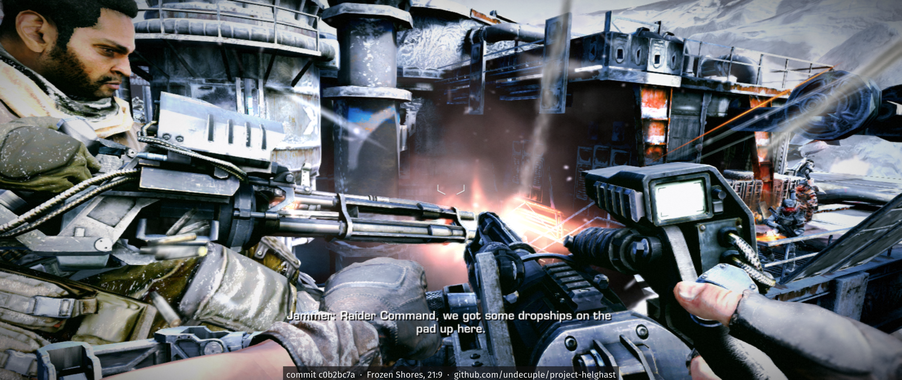

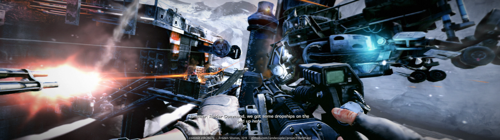

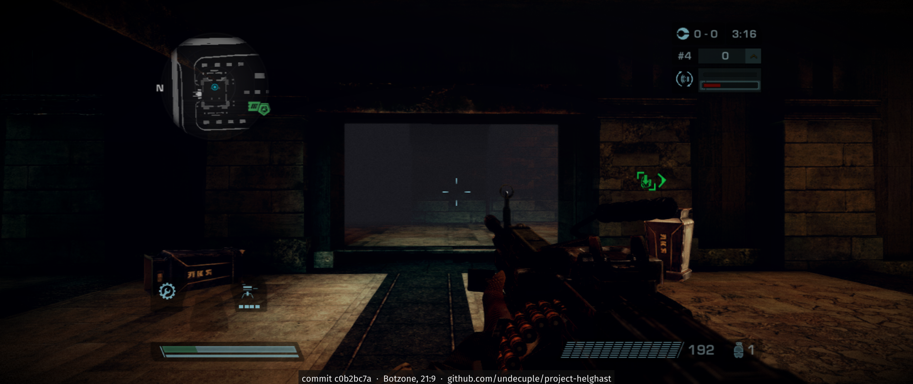

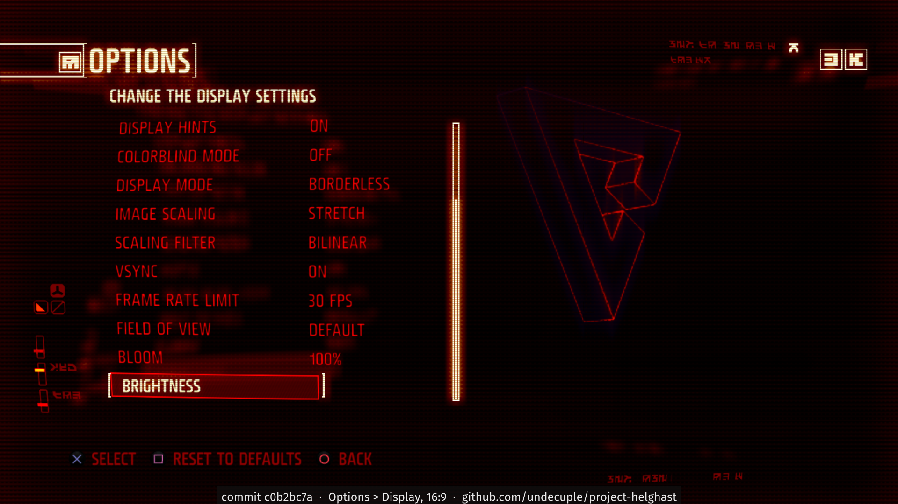

Wide windows: Frozen Shores at 21:9 (2560x1080) and 32:9 (3840x1080), and a Botzone match at 21:9. The 3D view
fills the window; subtitles and crosshair stay centred, and in the Botzone match the minimap, score box and ammo
counter sit in the 16:9 HUD area. Last, the Display page of the options at 1920x1080, with
its frame rate limit, field of view and bloom rows. Scripted runs on the build each bar names; no frame-rate box on
these.

## 2026-10-27 · Frozen Shores at 1920x1080

The Frozen Shores chapter at 1920x1080 (borderless window), a scripted run on the build its bar names; no frame-rate
box on this one.

## 2026-10-23 · Split-screen co-op

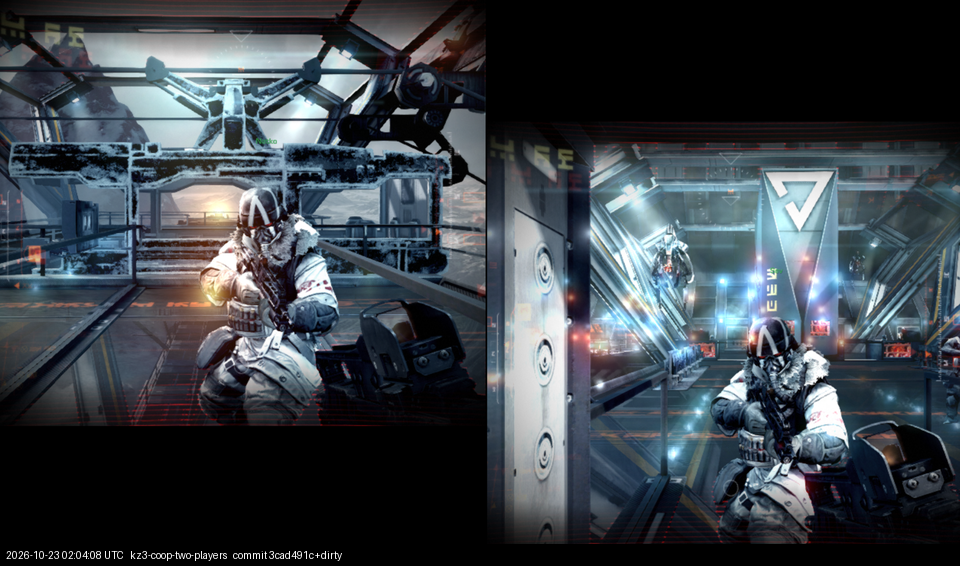

The game's own two-player campaign co-op on one PC, one controller per player (vertical split, first played on
2026-10-22). Known bug: the two views sit slightly out of place, one shifted up and the other down.

## 2026-10-16 · Update 1.14

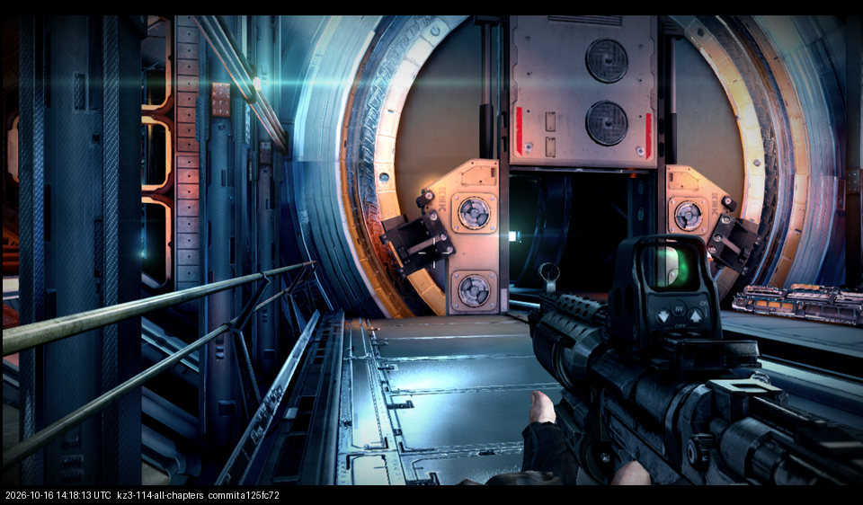

With the 1.14 update's data all nine chapters load their own level, reach the level start and write their autosave
without a crash (scripted runs of 5 to 6 minutes each); shown: the Space Station level.

## 2026-10-14 · All nine campaign levels play (backfilled)

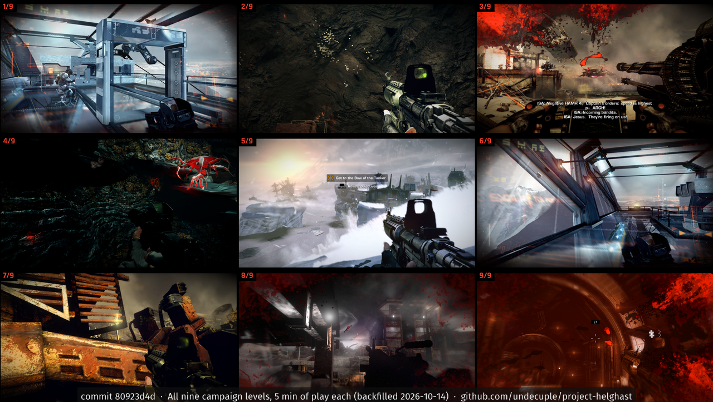

Each of the game's nine campaign levels loads from the chapter menu and runs five minutes of scripted play (move,
turn, fire) without a crash; 15.6 to 19.1 frames/s across the levels. Nine runs on one build, one frame from each.

## 2026-10-14 · The Hammer ride

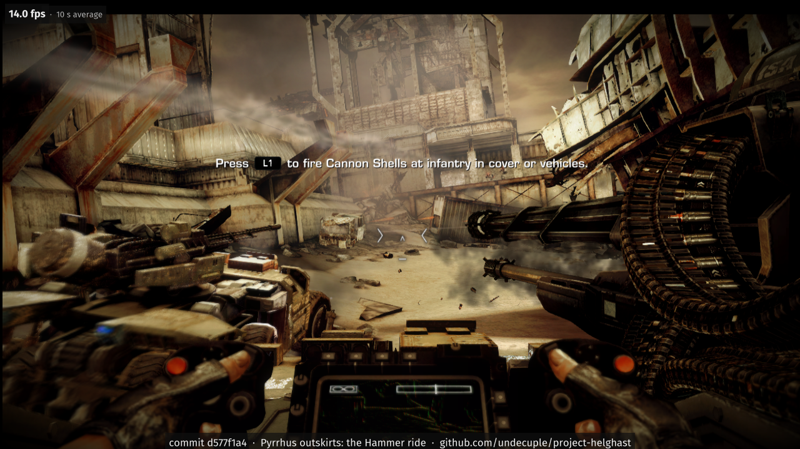

Pyrrhus outskirts: the player on the Hammer's mounted gun as it rides from the beach into the town. Before a fix to
the runtime's SPU DMA engine table the ride froze within seconds.

## 2026-10-13 · All levels load

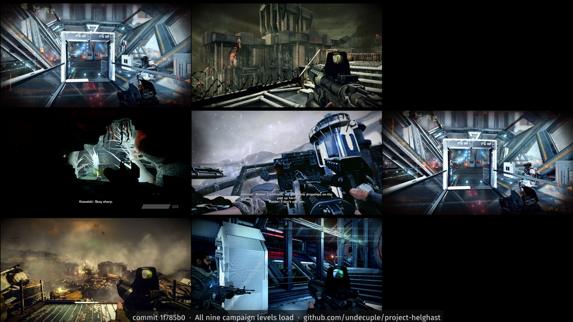

Every campaign level loads through Select Chapter from a completed save and reaches its level-start save.

## 2026-10-13 · Multiplayer squad lobby

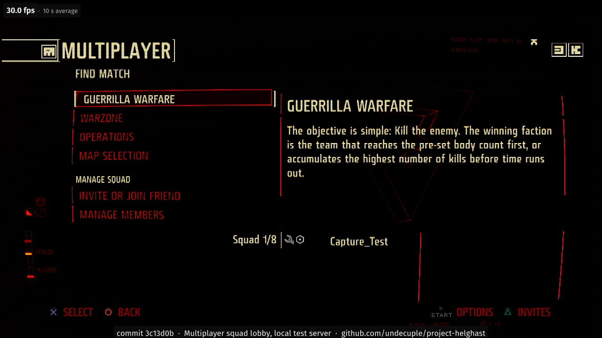

The game's own online client signs in to a local test server and opens the squad lobby (Guerrilla Warfare, Warzone,
Operations, Map Selection). Online play is opt-in; see "What goes online" in the [README](../README.md).

## 2026-10-12 · Frozen Shores

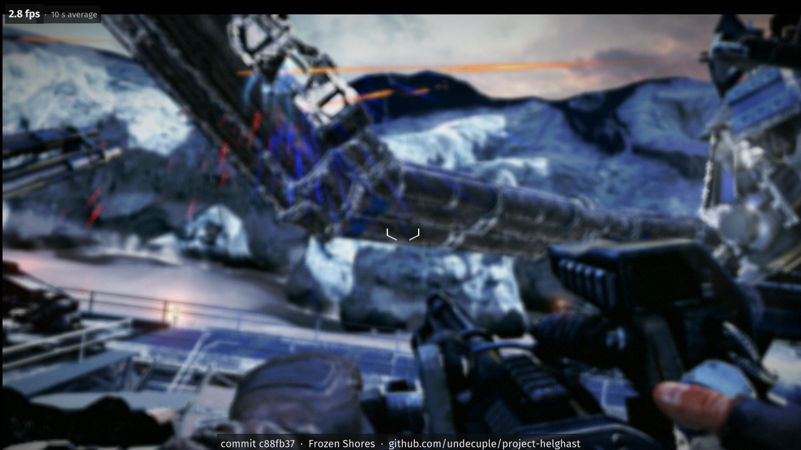

A later level, Frozen Shores: the mounted gun on the ice vehicle, tracers in the air.

## 2026-10-12 · In-level HUD

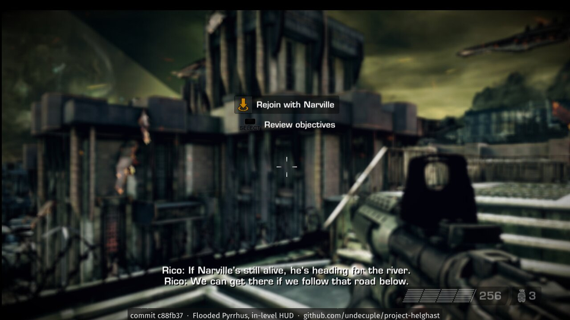

Flooded Pyrrhus with the in-level HUD: objective, subtitles, ammunition and grenade counts, crosshair.

## 2026-10-12 · Keyboard bindings

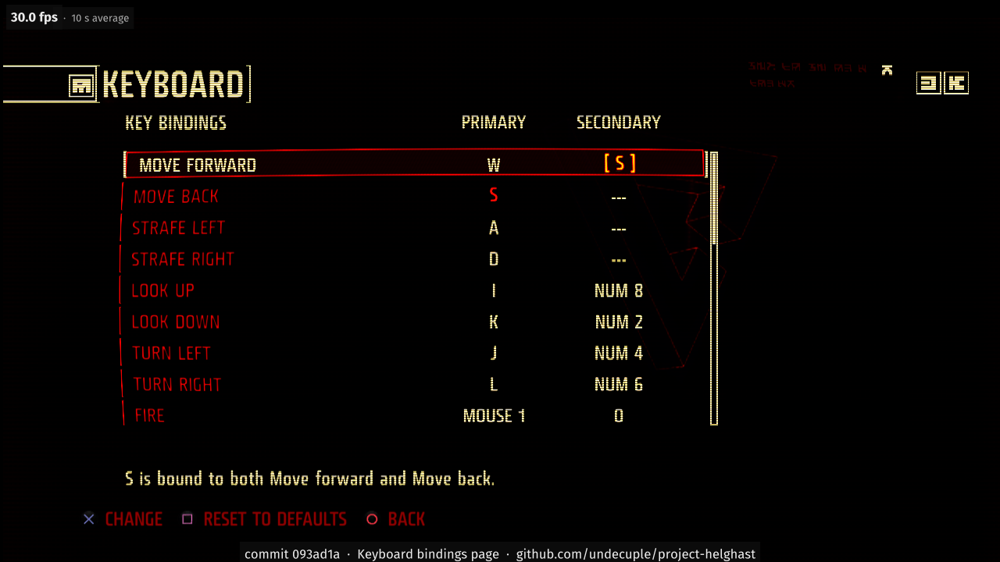

Keyboard and mouse: the port's own key-binding page, made in the game's menu style (primary and secondary keys,
a line for conflicting keys).

## 2026-10-09 · First level geometry

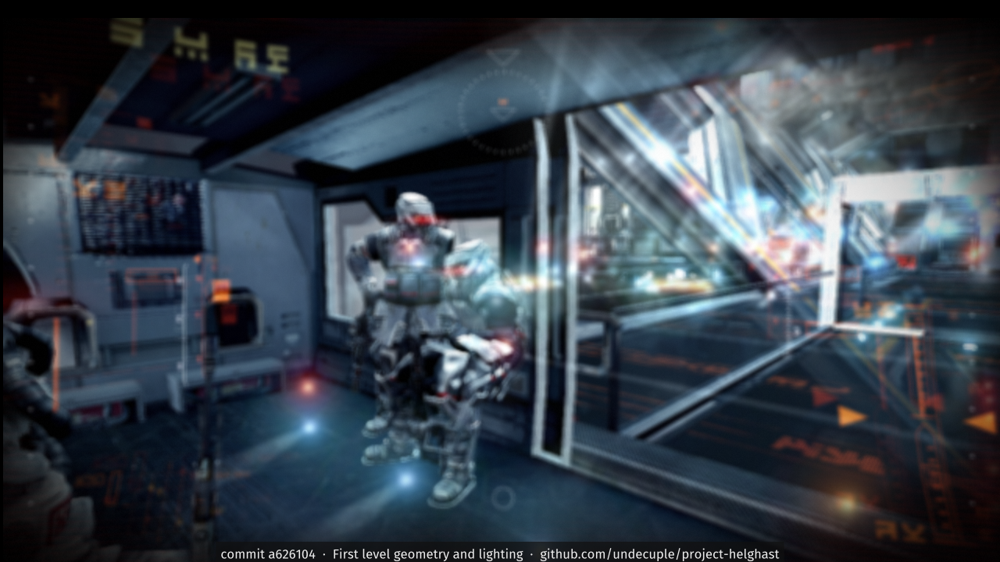

The first level drawn with solid geometry and deferred lighting: a Helghast soldier, a corridor, glass, lights and
the HUD.

## 2026-10-08 · Main menu

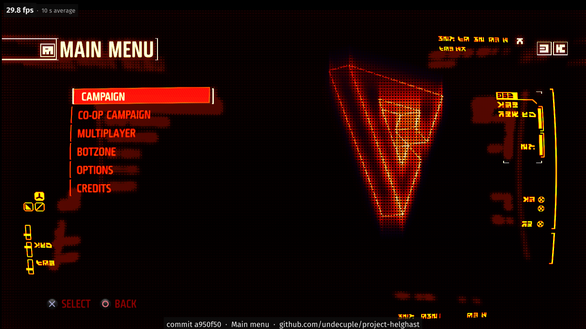

The main menu for the first time: Campaign, Co-op Campaign, Multiplayer, Botzone, Options, Credits.

## 2026-10-08 · Opening cinematic

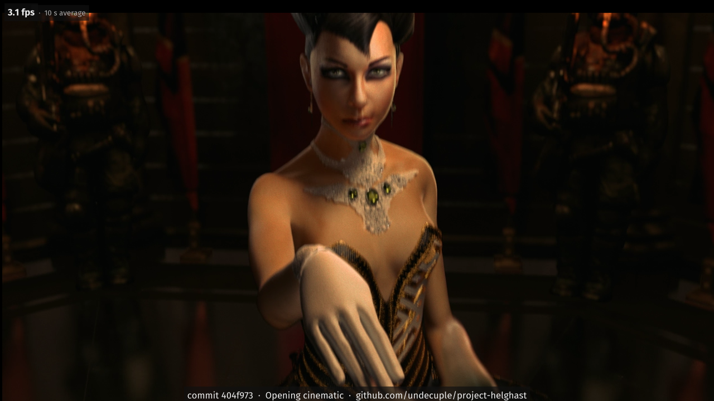

The opening cinematic plays after the intro.

## 2026-10-07 · First complete menu screen

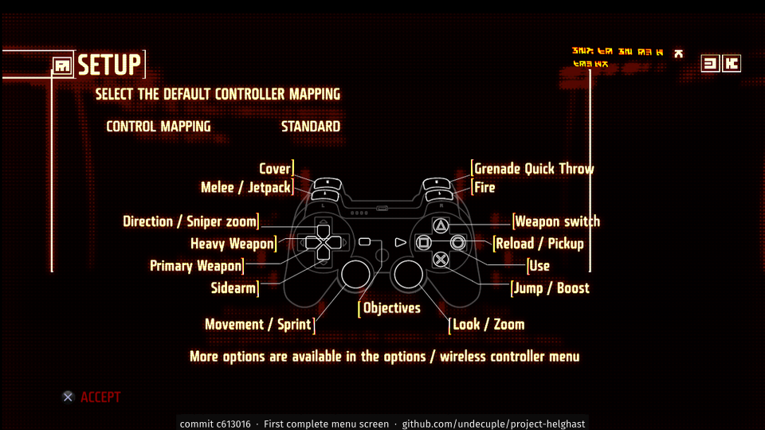

The first menu screen drawn complete with all its text: the game's controller-mapping page, after the boot movie.

## 2026-10-07 · First frame

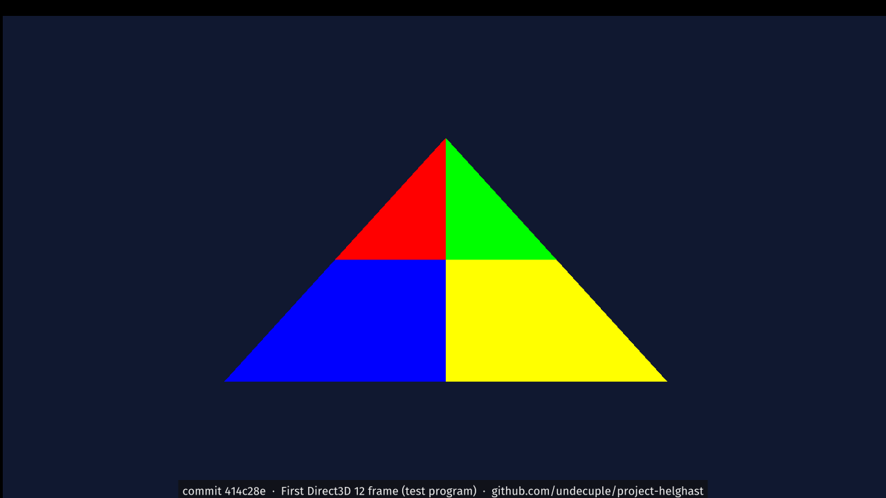

The first frame from the port's Direct3D 12 renderer: a test triangle from a small host program, before any game
code ran through it.
